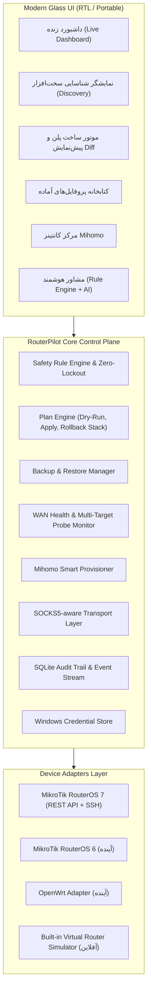

# 🚀 RouterPilot (نسخه ۱.۰)

> **سیستم مدیریت هوشمند، تراکنشی و امن برای روترهای میکروتیک (MikroTik RouterOS 7)**  
> *با طراحی مدرن Glassmorphism، پشتیبانی کامل از زبان فارسی و راست‌چین (RTL)، موتور پلن بدون قطعی و قابلیت کارکرد مستقل*

---

## 🌟 چشم‌انداز و فلسفه طراحی

**RouterPilot** با یک اصل حیاتی و غیرقابل‌مذاکره طراحی شده است: **«امنیت اول، هوشمندی دوم، راحتی سوم»**. هیچ تغییری هرگز به صورت کورکورانه روی روتر اعمال نمی‌شود.

### زنجیره تراکنشی ایمنی:
$$\text{Connect} \longrightarrow \text{Discover} \longrightarrow \text{Backup} \longrightarrow \text{Plan} \longrightarrow \text{Preview} \longrightarrow \text{Confirm} \longrightarrow \text{Apply} \longrightarrow \text{Test} \longrightarrow \text{Rollback (در صورت خطا)}$$

- **Zero-Lockout Guarantee**: موتور ایمنی هرگز اجازه حذف، فیلتر یا تغییر آدرس اینترفیس مدیریت یا بریج LAN را نمی‌دهد.
- **تأیید صریح کاربر برای عملیات حساس**: تغییر Default Route، حذف Firewall و بازنشانی تنظیمات همیشه نیازمند تأیید دستی است.
- **لایه‌بندی مدرن SOCKS5**: تمام تماس‌های خارجی (استعلام هوش مصنوعی، دریافت اشتراک، به‌روزرسانی نودها) به صورت پیش‌فرض قابلیت عبور از پروکسی SOCKS5 را دارند.

---

## 🏗️ معماری کلان نرم‌افزار



---

## ⚡ قابلیت‌های کلیدی

1. **شناسایی خودکار (Smart Discovery):**
   - معماری پردازنده (ARM, ARM64, x86, Tile, MIPS)
   - نسخه RouterOS و لود لحظه‌ای CPU و حافظه رم آزاد
   - فضای ذخیره‌سازی داخلی و تشخیص حافظه USB
   - اینترفیس‌ها، بریج‌ها، مک‌آدرس‌ها و وضعیت Running
   - خطوط WAN (از نوع DHCP Client، PPPoE، Static یا LTE)
   - رول‌های Mangle، NAT و مسیرهای جدول روتینگ

2. **سیستم پروفایل‌های آماده (Profile System):**
   - `MobinNet-TCT-Failover`: سوئیچ هوشمند و مانیتورینگ خطوط مبین‌نت و مخابرات
   - `Mihomo-Container`: راه‌اندازی کانتینر Clash Meta با دیسک USB و شبکه VETH
   - `Iran-Direct-Foreign-Proxy`: تفکیک خودکار ترافیک داخلی بانک‌ها و سرورهای خارجی
   - `Safe-Home-Router`: امن‌سازی پایه‌ای پورت‌ها و فایروال ورودی

3. **مرکز هوشمند Mihomo (Clash Meta):**
   - بررسی خودکار سازگاری پردازنده و رم
   - هدایت فضای نصب کانتینر روی USB برای جلوگیری از استهلاک حافظه داخلی روتر
   - اتصال مستقیم به پنل مدیریت وب MetaCubeX (`:9090/ui`)

4. **مشاور هوشمند دو لایه‌ای (AI Advisor):**
   - **لایه اول (قطعی و رایگان):** موتور داخلی Rule Engine برای کشف تداخل‌های روتینگ و نشت ترافیک
   - **لایه دوم (مدل‌های هوش مصنوعی):** امکان اتصال اختیاری به مدل‌های محلی یا کلود از طریق SOCKS5 بدون افشای مستقیم دسترسی روتر

---

## 📁 ساختار ماژولار پروژه

```
RouterPilot/
├── cmd/
│   └── routerpilot/
│       └── main.go                 # نقطه ورود برنامه پرتابل Go
├── internal/
│   ├── adapter/
│   │   ├── adapter.go              # Interface و مدل‌های ارتباطی
│   │   ├── mikrotik_v7.go          # آداپتور رسمی RouterOS 7 (REST API)
│   │   └── mock_router.go          # روتر مجازی برای تست بدون سخت‌افزار
│   ├── core/
│   │   ├── safety.go               # موتور قوانین امنیتی و Zero-Lockout
│   │   ├── plan.go                 # موتور تراکنشی Plan و Rollback
│   │   └── audit.go                # ثبت لاگ و تاریخچه ممیزی
│   ├── engines/
│   │   ├── health.go               # پایش سلامت خطوط WAN و تاخیر
│   │   ├── mihomo.go               # پرویژنر هوشمند کانتینر Mihomo
│   │   ├── proxy.go                # لایه انتقال امن SOCKS5
│   │   └── ai_advisor.go           # مشاور هوشمند و Rule Engine
│   ├── profile/
│   │   └── profile.go              # لودر و کامپایلر پروفایل‌های شبکه
│   ├── security/
│   │   └── credentials.go          # ذخیره امن رمزها با AES-GCM
│   └── api/
│       └── server.go               # وب‌سرور داخلی و REST API
├── web/
│   ├── index.html                  # رابط کاربری مدرن شیشه‌ای (Glassmorphism)
│   ├── css/style.css               # استایل‌های RTL، انیمیشن‌ها و دارک‌گلس
│   └── js/app.js                   # مدیریت وضعیت و ارتباط با موتورها
├── scripts/
│   ├── run_simulator.py            # اجراکننده مستقل و فوری ویندوز با پایتون
│   └── start_routerpilot.bat       # لانچر تک‌کلیکی ویندوز
├── tests/
│   ├── safety_test.go              # تست‌های ایمنی و عدم قفل‌شدگی
│   └── plan_test.go                # تست شبیه‌سازی و رول‌بک
├── .github/
│   └── workflows/
│       ├── test.yml                # تست‌های مداوم در گیت‌هاب
│       └── release.yml             # کامپایل خودکار فایل exe در Releases
├── go.mod
├── LICENSE
└── README.md
```

---

## 🚀 نحوه اجرا در ویندوز

### روش ۱: اجرای فوری و مستقیم (بدون نیاز به نصب هیچ ابزار جدید)
از آنجا که پایتون روی ویندوز شما نصب است، کافیست فایل زیر را اجرا کنید:
1. روی فایل **`start_routerpilot.bat`** دابل کلیک کنید.
2. برنامه به طور خودکار مرورگر شما را روی آدرس **`http://127.0.0.1:8080`** باز می‌کند.
3. می‌توانید در حالت شبیه‌ساز (Simulator Mode) یا اتصال واقعی با رابط شیشه‌ای کار کنید.

### روش ۲: کامپایل با Go
```bash
go build -ldflags="-s -w" -o RouterPilot.exe ./cmd/routerpilot
./RouterPilot.exe
```

---

## 📦 نحوه انتشار در گیت‌هاب (GitHub Deployment)

این پروژه به طور کامل برای بارگذاری در گیت‌هاب کانفیگ شده است:

```bash
# ۱. اتصال به ریپازیتوری دلخواه شما در گیت‌هاب:
git remote add origin https://github.com/<نام-کاربری-شما>/RouterPilot.git

# ۲. ارسال کدها به شاخه اصلی:
git push -u origin main

# ۳. برای ایجاد خودکار فایل RouterPilot.exe در بخش Releases گیت‌هاب:
git tag v1.0.0
git push origin v1.0.0
```
> [!TIP]
> به محض push کردن تگ `v1.0.0`، اکشن‌های گیت‌هاب (`.github/workflows/release.yml`) به طور خودکار فایل اجرایی پرتابل ویندوز (`RouterPilot.exe`) را کامپایل کرده و در صفحه Releases قرار می‌دهند.

---

## 📄 مجوز (License)

این پروژه تحت مجوز **MIT License** منتشر شده است.
